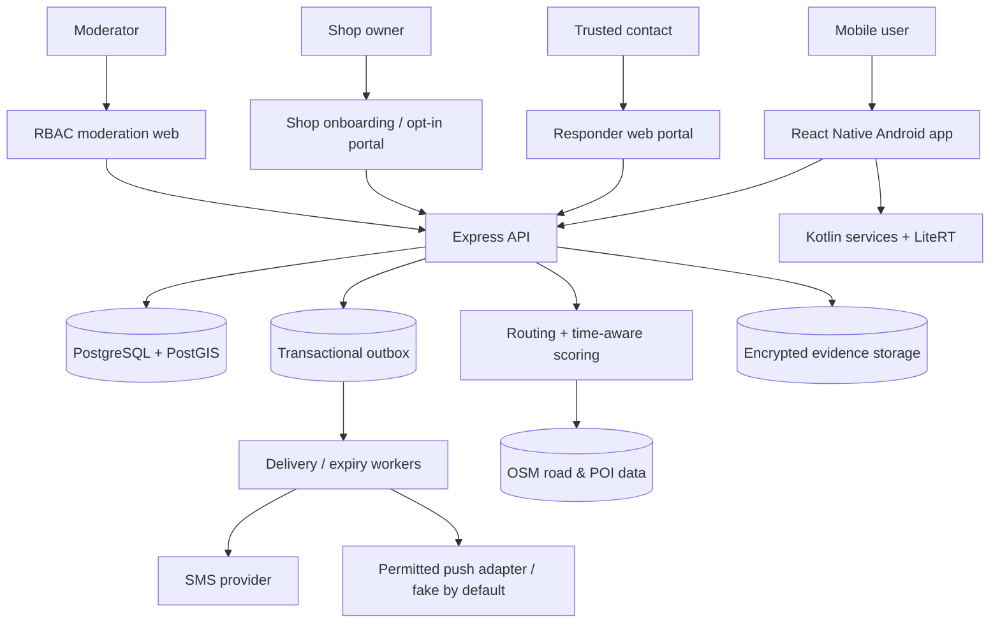

# 03 — Technical architecture

## Chosen baseline architecture

**Mobile:** React Native + TypeScript, Android-first with Kotlin modules for foreground service, sensor access, local inference and hardware-key feasibility.  
**API:** Node.js + TypeScript + Express, structured request validation, auth verifier and transaction layer.  
**Database:** PostgreSQL + PostGIS; one durable source of truth for users, contacts, events, journeys, reports, shops and graph features.  
**Async:** PostgreSQL outbox plus worker (Postgres-backed job mechanism) to avoid requiring Redis in initial version.  
**Web:** Next.js + TypeScript responder portal and role-protected moderation pages.  
**External adapters:** Firebase phone OTP (project/terms/quotas validated separately), provider-neutral push and transactional SMS, maps/geocoding/routing, private evidence storage. Live FCM emergency use is blocked by the verified restriction in D30; fake push satisfies development tests only.  
**ML:** offline-trained classifier and rule/calibration layer run on device with LiteRT (Kotlin bridge).  
**Maps:** OSM-derived network + GraphHopper candidate paths in a pilot area, custom scoring service; always verify licensing, rate limits and completeness.

## Context diagram

## Domain boundaries

| Module | Owns | Must not own |
|---|---|---|
| Identity | Firebase token verification, app user mapping, minimal profile | emergency dispatch |
| Contacts | verified recipients, consent, priority, optional location sessions | arbitrary device location access |
| SOS | event state machine, recipient selection, tracking grants, outbox records | waiting for ML/media |
| Delivery worker | SMS/push adapters, retries, provider receipts, escalation | core transaction decision |
| Locations | position ingestion, freshness, retention, browser updates | background capture without permission |
| Journeys | ETA, arrival check-in, overdue timer | direct provider sends bypassing SOS |
| Routing | candidate routes, segment factors, score version, reasons | hardcoded 'safe/unsafe' facts |
| Reports | incident intake and moderation | immediate automatic public flagging |
| Shops | applications, verification, hours, opt-in messaging | public exposure of private owner data |
| ML/native | on-device audio/motion classification, foreground state | server-side raw audio inference by default |
| Evidence | explicit opt-in media uploads + secure viewing | sharing media in SMS URLs |
| Duress/stealth | fake-call UI, duress PIN, key trigger experiment | bypassing Android protections |

## SOS critical path

1. Mobile obtains a last-known position with `captured_at` and accuracy; begins new fresh fix in parallel.
2. `POST /v1/sos` with idempotency key; API verifies ownership, creates event & minimal tracking grant, writes `notification_outbox` records in a single DB transaction.
3. Respond immediately with `{event_id,status:'CREATED',dispatch_status:'QUEUED'}` (or NO_ELIGIBLE_RECIPIENTS); app does not claim delivered.
4. Worker sends prioritized alert, records per-recipient/provider status; retries bounded transient failures.
5. Mobile posts location updates independently; web displays timestamp/freshness. Background context/photo/audio are add-ons, never blocking step 2.
6. Acknowledgement and escalation handle no-contact/no-location; once resolved, revoke recipient grants and stop sharing.

## Contact ranking and privacy

Only the user's *configured* contacts participate. If a contact explicitly grants a live location session, is eligible, and has a position not older than the defined freshness budget (default 5 minutes), rank by distance. If no eligible live locations, rank by user-defined priority. All designated contacts get an initial basic SOS by default; the nearest eligible contact receives the **priority contextual alert**, and escalation bumps alternates. This policy can be configured after explicit product review; never silently withhold all alerts because ranking fails.

## Data architecture

- Store location as PostGIS `geography(Point,4326)` and keep timestamp/accuracy/source; use GiST spatial indexes and `ST_DWithin` for nearest assistance points.
- TTL/retention jobs purge old location trail, stale responder-location sessions, media and raw reports independently from emergency event summary.
- Incident and place layers have provenance, moderation state and freshness. Do not train on unverified reports as if ground truth.
- Event audit contains *minimal metadata*, no raw media or access tokens.

## Deployment and environments

Local Docker Compose: API, PostgreSQL/PostGIS, worker, web, fake SMS/FCM/mapping adapters, seed demo data. Staging: isolated test Firebase project + sandbox SMS; production: separate secrets and budgets; use HTTPS and managed DB if available.

## Failure modes

| Failure | Expected behavior |
|---|---|
| No GPS fix | SOS still created; send last known with age or 'location unavailable' |
| No internet | Provide local emergency call option; locally queue event for later retry, **not guaranteed dispatched** |
| SMS provider down | Alternative provider only if actually configured; keep queue, show provider failure and local call path |
| Background service killed | Visible degraded-monitoring status when next active; do not claim continuous coverage |
| Route/scoring unavailable | Show standard routing/112/manual SOS without a fabricated safety score |
| Media upload fails | SOS stays active, media marked unavailable; never revoke successful alerts |
| Contact location unavailable | Use priority order; never infer location from phone number |

## Integration contract

Types live in `packages/contracts` when implementation starts. Schema version in each event/report response; API at `/v1`; MIME JSON except signed media upload. See `05_API_CONTRACTS.md` for error and idempotency conventions.

## Definitive implementation design — review-1.2

The [master plan](EXECUTION_MASTER_PLAN.md) fixes exact planned module paths and50 tasks. [Contracts](INTEGRATION_CONTRACTS.md) own interfaces; [data model](04_DATA_MODEL.md) owns persistence. Avoid extra architecture documents and duplicate domain implementations.

**Mobile:** Bare React Native0.88 supported line at review, TypeScript, React Navigation, generated fetch-client wrapper and query cache for noncritical screens. Native Kotlin is authoritative for Firebase SDK auth, encrypted account-bound SOS journal/transport, location service and monitoring; JS subscribes to state and submits commands through typed TurboModules. Use Android Keystore-wrapped encryption for journal/PIN secrets; do not store tokens/PIN/GPS in AsyncStorage or backups. Sensor streams and inference never cross the JS bridge as raw arrays/audio. Native purpose registry independently tracks SOS/journey/monitoring, expiry and stop actions. User-started location FGS needs foreground coarse/fine permission, not background-location by default; mic is a distinct explicitly activated type/capability. No boot restart.

**Backend:** Node26 LTS + Express5 TypeScript modular application; pg parameterized SQL and versioned SQL migrations rather than an ORM plus a second geospatial access path. Modules own services/repositories/validators/routes; routes authenticate/validate then call services. Worker imports the same domain transaction/notification services without routing through Express. No circular module imports: shared platform→domain services→HTTP/worker entrypoints, with SOS creation interface injected into journeys, never journeys imported into SOS.

**Web:** One patched Next16 app serves responder/contact/shop/admin pages; same-origin HTTPS reverse proxy routes /v1 to Express. Express owns authorization and business mutations; Next does not use direct DB/service-role keys. Client tracking fetches no-store projections, visible poll10s, background60s with event revisions; no realtime socket dependency. Grant-named cookies prevent scope collision between tabs. Private landing/bootstrap excludes third-party analytics/scripts; maps/tiles load only after token removal and approved provider configuration. Text/coordinate status remains functional if renderer fails.

**Database/jobs:** Supported PostgreSQL17 plus compatible PostGIS3 image pinned by digest in P1. Migration owner B at services/api/migrations only. Transactions lock intents/events/journeys for races; unique constraints protect logical event/notification identities. Outbox and scheduler lease via SKIP LOCKED, no provider call inside transaction. Route import/CPU work is low-priority and cannot starve emergency connection pool. Bound queries/payloads/DB pool and async timeouts; use statement/lock timeout appropriate to critical write, tested under load.

**Maps/scoring:** GraphHopper walking routing container has no public user-facing API; Node adapter converts provider coordinates/segments/time and maps versioned edges to PostGIS factors. Candidate generation and temporal scoring remain separate: score only returned legal paths at estimated arrival times. MapLibre RN and web renderer use configured permitted tiles; rendering is separate from routing and data. Destination search begins with map selection/coordinates and local imported place index; public Nominatim is not an autocomplete or emergency dependency. Reverse landmark lookup is optional asynchronous enrichment. Every factor includes provenance/validity/coverage; confidence is observed coverage and larger v1 risk_indicator means more favorable estimated conditions.

**Notifications:** Initial basic intents to all verified trusted contacts; context accessible only in portal. Priority matching uses already-stored eligible GPS or deterministic priority; no waiting for recipient location or ETA. SMS/push adapter capability flags distinguish delivery receipts, query/reconciliation and provider idempotency. FCM warning is a live deployment blocker, not a delivery-optimization issue. Authenticated browser ACK is separate from message transport receipt.

**Evidence/ML:** Bundled LiteRT CPU Interpreter/model with checksum/tensor/preprocessing manifest and independent evaluation. Sensors default off; model graduation does not imply real-world assault detection. In-memory inference audio is never implicitly retained/uploaded. Explicit audio/photo/user-selected short video after separate consent uploads to S3-compatible quarantine, validated/sanitized/scanned, then authenticated API streaming with per-asset recipient scope. No background camera or public read URL; resolve/delete/withdraw revoke access before asynchronous erasure.

**Shops/admin:** Verified active participants differ from imported candidatePOIs. Shop owner identity, consent/agreement, schedule, confirmation and closure override are independent. Moderator scope only reports/shops; no privateSOS/media. User selects shop alert, separate15min grant; shops never enter trusted-contact ranking.

**Deployment/secrets:** Local Docker Compose with API/worker/web/PostGIS/Auth emulator/fakes; routing container added P2 and fake/S3-compatible storage/scan inP3. Windows uses Docker Desktop/WSL2 or documented remote dev environment if available; native Android builds use host Android SDK. Staging and pilot separate Firebase projects, DBs/buckets/domains/signing configuration and secret stores. Deploy API/worker/web as long-running containers on one managed container platform/VM for a controlled pilot, managed PostGIS DB and private object storage where supplied. No serverless-only scheduler, Kubernetes or public DB/router required. Cloud/vendor/region spending needs deployment-owner choice after concrete sizing/config; local work continues.

Use HTTPS ingress/TLS, restrictive CORS/CSP, Secure/HttpOnly cookie scopes and CSRF/Origin checks. Server credentials via secret manager/injected environment/workload identity, never app config; mobile Firebase public identifiers are not backend secrets. CI uses least-privilege deploy identities, secrets scanning/SBOM, isolated fake-provider egress and signed mobile release key kept outside Git. Quotas/budget alerts/fault mode are deployment artifacts, not guessed accounts.

**Observability/operations:** Structured request/intent/job IDs, status/error category, latency and version; no raw phone/GPS/token/evidence/PIN. Metrics include outbox age, UNKNOWN/DEAD rates, scheduler lag, location freshness, route coverage and user-activated monitoring downtime. Worker readiness/health reports DB/lease capability, not external SMS availability; graceful shutdown stops leasing and finishes/releases owned work. B owns operational runbooks until a pilot operator is named. Backup/restore and deletion-ledger reconciliation precede pilot traffic; additive migrations allow rollback to previous compatible app. Detailed timings/budgets/gates are in [testing](TESTING_AND_ACCEPTANCE_GATES.md).
