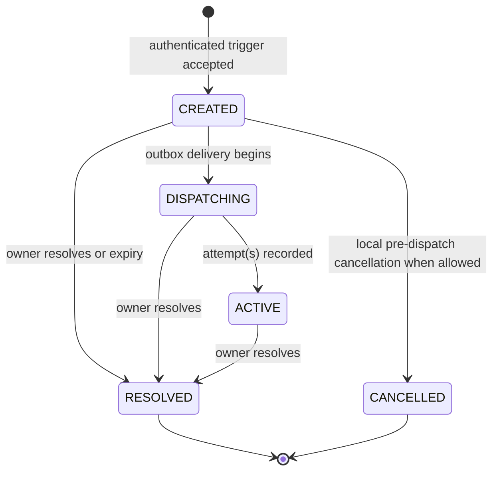
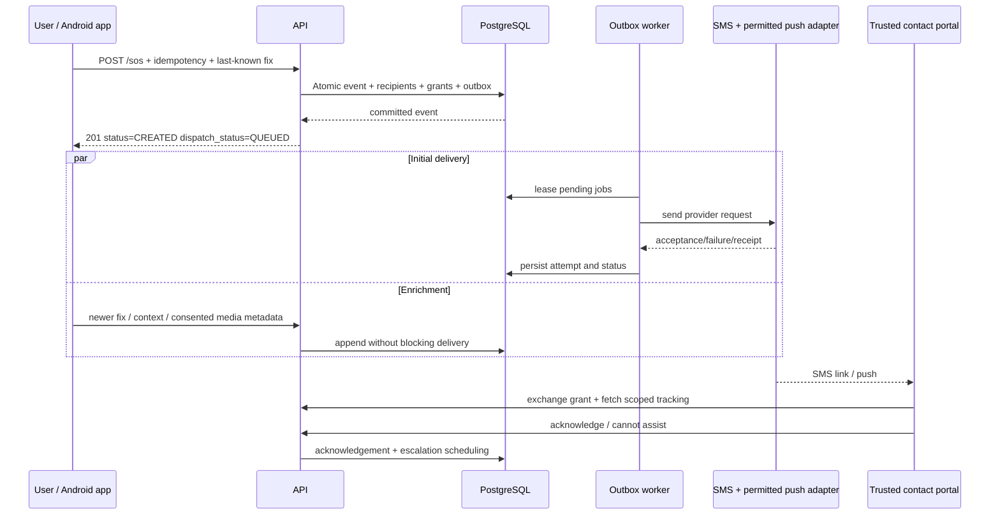

# 06 — SOS, notifications, responder matching and journey state machines

## Event states

`ACTIVE` means the emergency workflow remains open; **not** proof messages reached a person. Maintain independent recipient delivery state. Resolve does not undo messages already sent.

## Manual SOS sequence (fast path)

## Recipient selection — explicit team requirement

Candidate pool = **only** configured, verified, non-revoked contacts (3–5). For `CONTACT_PRIMARY` choose:

1. Has opted into temporary contact GPS sharing; session active; last location <= 5 min old; current precision adequate.
2. Rank eligible candidates by direct distance (`ST_Distance`) as a proximity *estimate*; if routing available, report ETA separately and do not claim straight-line distance is travel time.
3. Ties by configured priority then stable contact ID.
4. If none have usable current location, choose user-defined priority order.

Delivery recommendation: send a **basic SOS immediately to all designated contacts**, plus a **priority/contextual responder packet** to nearest contact; an alert escalation can re-prioritize to contact B if A does not acknowledge. This prevents a single recipient/location outage becoming a single point of failure. If team chooses primary-only delivery instead, it must be an explicit ADR with failure-mode testing.

**Response policy (prototype defaults, adjustable):** primary recipient acknowledgement target 30s; if they reject / cannot help, escalate immediately; if no acknowledgement at 30s, promote another contact and send context. Do not delay sending initial alerts while evaluating location/ETA. User-visible delivery states: queued, provider accepted, recipient acknowledged, confirmed delivery where supported, failed.

## Contact page content

- Emergency status and trigger class (`automatic potential distress` vs `manual SOS`, not asserting assault happened).
- User's location, accuracy, **last updated timestamp**, age warning if old/unavailable.
- Map directions, estimated route/ETA of recipient if recipient shares starting point; otherwise generic 'Open directions' without personalized ETA.
- Battery % if available; device motion/speed with freshness/confidence and units, no definitive claim of violence; nearby landmark as best-effort label.
- Evidence cards only if explicitly captured and recipient grant authorizes access, access audited and securely streamed. No public media URL.
- Buttons: `I can help`, `I can't help`, `Call 112`, `Open directions`. Presence of a responder acknowledgement isn't proof of safety.

## Emergency access control

Recipient obtains an expiring, revocable opaque grant; only a browser is required. Token hash stays in DB; explicit exchange for a short grant-named HttpOnly cookie is mandatory. Retry binding/multiple-tab isolation follow integration section11. On resolution/expiry, deny location/media and clear private UI. A2h grant does not silently extend a24h event; deliberate owner reissue is required.

## Offline scenarios

- No data service: app shows `Not sent — offline` and offers native phone dialer to 112. Cached request can replay once service resumes, but a safety message explicitly states it was *not* sent. Do not show fake success.
- Last known fix only: send with `Last updated N minutes ago` and accuracy; attempt active fix in parallel.
- SMS gateway/provider rate limited: retry per backoff policy; alternative push only with a registered recipient device and a permitted configured provider. Follow D30; no offline gateway-SMS guarantee.
- Contact doesn't acknowledge: escalate; avoid spam storms via cooldown and per-event dedupe.

## Journey state machine

`ACTIVE → ARRIVED` if user confirms; `ACTIVE → OVERDUE` if deadline passed; `OVERDUE → ACTIVE` if user extends, or `OVERDUE → ESCALATED` after configured check-in grace; `ACTIVE/OVERDUE → CANCELLED` on explicit termination. Persist server-side scheduled jobs so Android process death does not eliminate deadline processing.

- Default prototype grace: send a discreet check-in at ETA, wait 2 minutes for response, then create `JOURNEY_OVERDUE` SOS; user-configurable with clear UI. Time zone and DST calculated from UTC, not client clock.
- A user can disable auto-escalation when starting journey, but UI must explicitly show that choice; tests cover arrival just before/at/after deadline and duplicate schedulers.
- No autonomous notification of police or strangers.

## Alert content version

The context-rich object previously called alert_v1 is the authorized portal projection, not a notification transport payload. The canonical versioned internal alert_v1 and minimal push/SMS payloads are in [integration section6](INTEGRATION_CONTRACTS.md). No raw coordinates, media or sensitive battery/motion context on lock-screen messages. Optional evidence is attached asynchronously and separately scoped. Live FCM emergency sending is blocked under D30.
