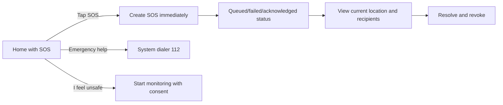

# 12 — Screen inventory, UX and accessibility contract

## Experience principles

The user may be frightened, moving, have one free hand, be observed by another person, or have low network/GPS/battery. Make deliberate SOS the most accessible action; do not bury it behind sign-in if a native emergency phone call can still be offered. Clearly show *queued*, *provider accepted*, *acknowledged*, *not sent* and *location stale* states. No congratulatory 'sent' animation before actual delivery knowledge.

## Mobile navigation

| Screen | Essential controls / states |
|---|---|
| Welcome/permissions | phone OTP, privacy disclosure, progressive permissions, emergency call even without signup |
| Home/SOS | large high-contrast one-tap SOS; explicit test mode; trusted contacts count; emergency 112 button |
| Contacts | add 3–5, priority order, invite/verify, expired/no contact-GPS indicator, revoke |
| Journey | destination, departure/ETA, route variants and confidence, activate/arrived/extend/cancel |
| Route detail | fastest/balanced/lower proxy-risk, travel detour, data coverage, factors and sources |
| SOS active | current recipient statuses, location freshness, stop location sharing/resolve, call 112, share failure notice |
| Alert history | event time, trigger, status, summary, privacy-controlled deletion |
| Monitoring | explicit start/stop, mic+motion permission, recording indicator, battery impact, degraded state |
| Safe shops | map/list, estimated status (`confirmed`, `scheduled`, `unknown`), call/directions, status legend |
| Fake call | schedule/immediate, preview, discreet quick exit |
| Fake PIN setup | normal/duress PIN separate, safety warning, rehearsal simulator, secure reset |
| Settings/privacy | contact-sharing controls, evidence opt-in, session expirations, data export/delete, help |

## Receiver web (no app install)

- Enter via expiring tracking grant; first display alert timestamp, current status and **last-location freshness**.
- Show map with current/last-known pin and accuracy ring. `Location unavailable` must be an explicit state.
- `I can help`, `Cannot assist`, `Open directions`, `Call 112` buttons. Do not automatically expose responder location.
- If recipient agrees to location-based ETA, request browser geolocation separately; decline has no effect on reading the SOS.
- Evidence hidden behind explicit authorized click, not autoplayed; show permissions and capture times.

## Moderation web

A private admin navigation: pending incidents, pending shops, review detail (sanitized), approve/reject with reason, owner-verified state, geographic coverage analytics. No default access to ongoing private SOS alerts or personal recordings.

## Wireflow for SOS home

## Accessibility and localization

- Respect Android font scaling and TalkBack; 48dp+ interactive targets; no color-only risk encodings; avoid red-green-only score interpretation; haptic/visual and optional spoken cues.
- Hindi and English UI labels, time/number formatting, India E.164 phone display; full translation review of emergency messages and consent warnings.
- Low motion and dark mode; large labels and plain instructions. Avoid voice-only trigger, complicated gestures as sole path, or mandatory back-and-forth confirmations in actual SOS.
- Test with weak network, small screens, screen readers, no GPS, denied mic, revoked contact, and one-hand usage. Formal usability testing should not simulate real personal endangerment.
